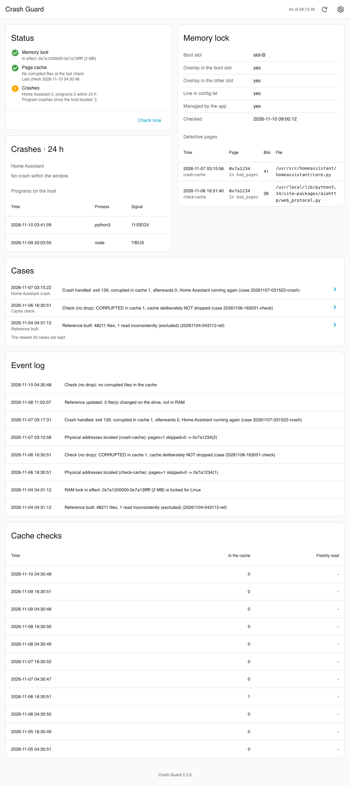
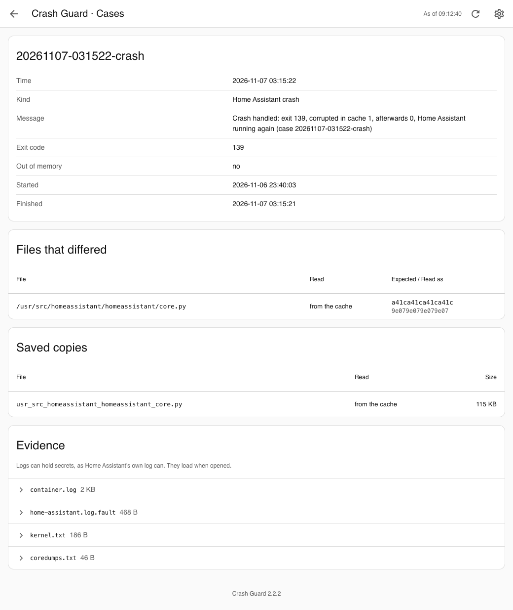
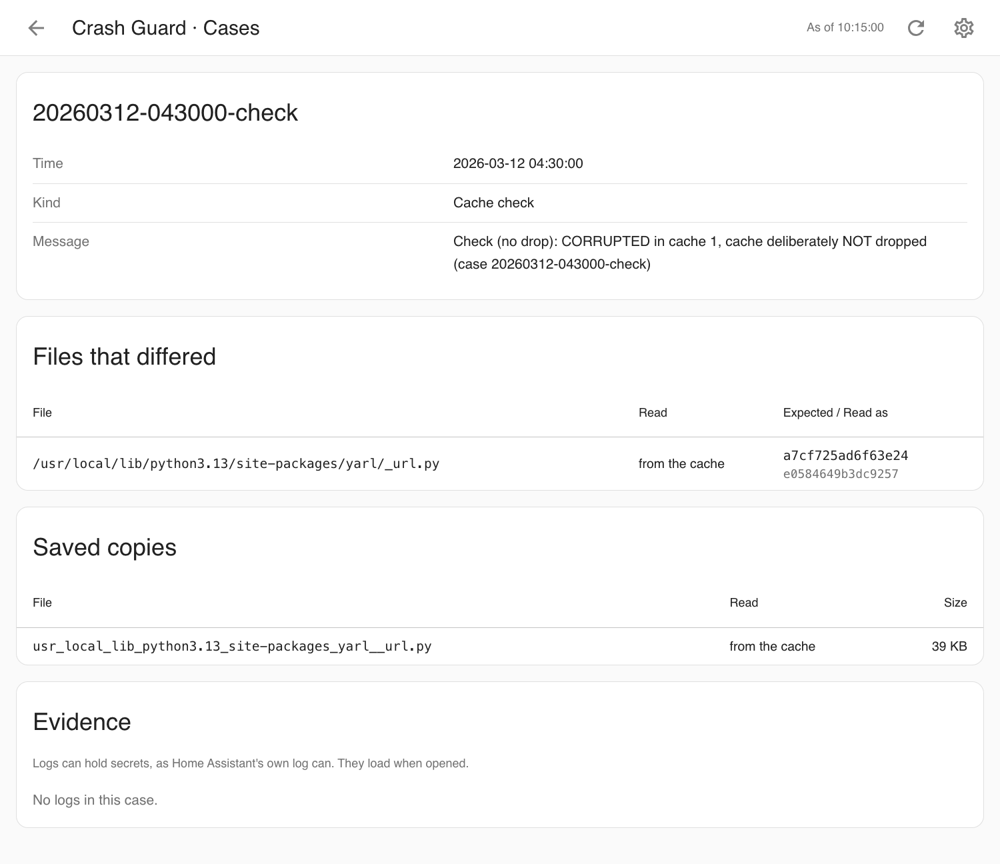
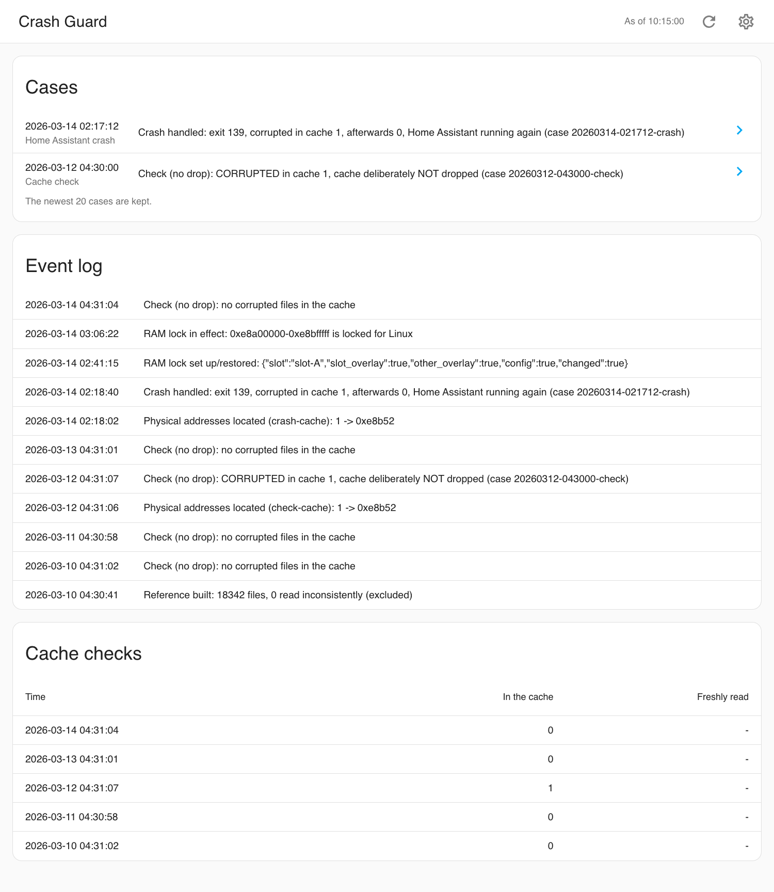
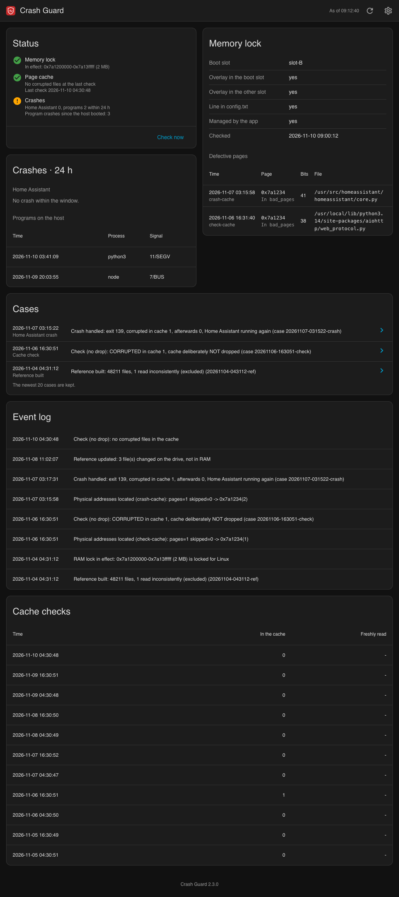
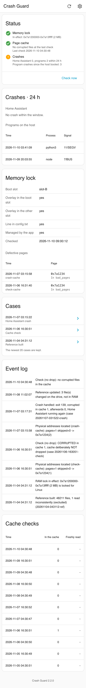
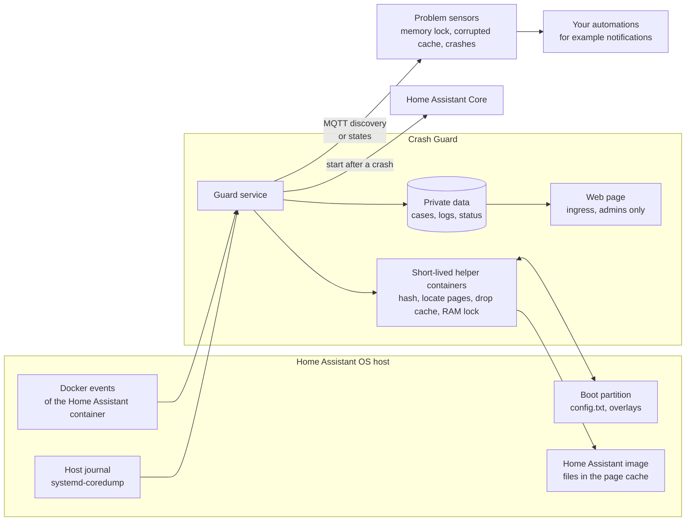

# Crash Guard app for Home Assistant

[](LICENSE)


A Home Assistant app for everything about crashes on a Home Assistant OS host: it counts crashes of every host program, catches crashes of Home Assistant itself, saves evidence and brings it back up, checks the page cache for corrupted files (the typical trace of defective RAM) and, on a Raspberry Pi, locks defective RAM pages away from Linux through the device tree, so the host keeps running until the board is replaced. Everything it finds is on its own page in Home Assistant; three problem sensors tell automations when something is wrong. Requires Home Assistant 2026.11 or later.

> [!WARNING]
> Crash Guard needs the Docker API, privileged helper containers, the Supervisor API (to start Home Assistant), the host journal and, for the RAM lock, write access to the boot configuration. Together that is full control over the host. Read [what the app may do](crash_guard/DOCS.md#what-the-app-may-do) before installing it.

## Screenshots

The page, made up for these pictures. It looks like Home Assistant's settings, takes over the theme in use, speaks the language of Home Assistant's interface (German or English) and shows the app's version at the bottom.



A Home Assistant crash the app handled: exit code, the file that was corrupted in the cache, its saved copy and the evidence:



A cache check that found a corrupted file:



The cases, the event log and the cache checks; the overview in dark mode and on a phone:







## Overview



The guard service watches the Home Assistant container and the host journal, checks the page cache at fixed times and keeps the RAM lock in place; the short-lived helper containers do what needs more rights. Everything it finds stays in its private data, where the page reads it. How each part works, with diagrams of the crash handling and the cache check, is in [the documentation](crash_guard/DOCS.md).

## Installation

1. Add the repository to your Home Assistant instance:

   [](https://my.home-assistant.io/redirect/supervisor_add_addon_repository/?repository_url=https%3A%2F%2Fgithub.com%2Fn-schilling%2Fha-app-crash-guard)

   Or add it manually: **Settings → Apps → Install app → ⋮ → Repositories**, then paste:

   ```text
   https://github.com/n-schilling/ha-app-crash-guard
   ```

2. Install **Crash Guard**, turn off its **Protection mode**, review the options and start it. Crash Guard needs the Docker API, which protection mode withholds; with it on, the app stops with a message saying so.

See [the documentation](crash_guard/DOCS.md) for the options, the page, the sensors and troubleshooting. Changes are listed in the [changelog](crash_guard/CHANGELOG.md).

## Development

The guard service is Bash in [`crash_guard/rootfs/etc/s6-overlay/s6-rc.d/guard/run`](crash_guard/rootfs/etc/s6-overlay/s6-rc.d/guard/run) with its libraries in [`crash_guard/rootfs/usr/local/lib/crash-guard`](crash_guard/rootfs/usr/local/lib/crash-guard); the helpers and the page are Python in [`crash_guard/rootfs/usr/local/bin`](crash_guard/rootfs/usr/local/bin). The page's look comes from the stylesheet shared by these apps, [`ha.css`](crash_guard/rootfs/usr/local/share/ha-app/ha.css), and its language from the script shared by them, [`ha-lang.js`](crash_guard/rootfs/usr/local/share/ha-app/ha-lang.js); both stay identical in every app.

```bash
scripts/check.sh
```

`scripts/check.sh` runs what CI runs (changelog, shellcheck, ruff, the image built for this machine with the app, guard and page tests inside it, the page of that image in a browser, and the test against a real Mosquitto broker; `--no-docker` skips what needs Docker). The page check and the screenshots are one script, `scripts/screenshots.py` (see its header for the setup): it starts the built image with made-up data in a throwaway container behind a stand-in for Home Assistant's ingress, checks the page with headless Chromium and, without `--check`, takes the pictures.

Releases: work on `dev`, raise `version` in `crash_guard/config.yaml` and add its section to the changelog. CI runs on `dev` (amd64 and aarch64 each on a runner of its own kind); once it is green, push that commit to `main`. CI does not run again there: the release workflow checks that CI passed for the commit, then tags the version and publishes the release with that section.

## Support

Questions, bugs and ideas: [open an issue](https://github.com/n-schilling/ha-app-crash-guard/issues/new/choose) in this repository. Security problems: see [SECURITY.md](SECURITY.md).

## License

[Apache License 2.0](LICENSE)
