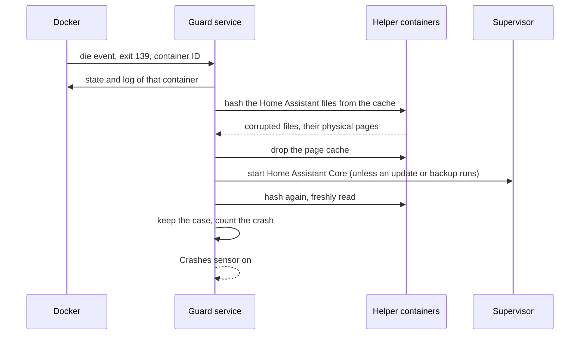
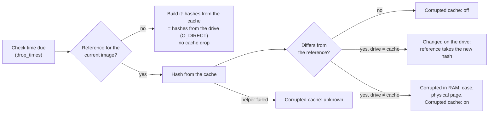

# Crash Guard

Defective RAM cells corrupt data in the page cache. Home Assistant then crashes when it imports a corrupted file, often right after a start, and a container restart does not help, because the corrupted copy stays in the cache. Crash Guard handles that:

1. **Catches crashes.** When the Home Assistant container exits with a signal (SIGSEGV, SIGBUS, SIGILL, SIGABRT, SIGFPE), it saves evidence, drops the page cache and starts Home Assistant again, at most `max_restarts_per_hour` times an hour.
2. **Checks the cache.** At `drop_times` it hashes all Home Assistant program files through the page cache and compares them with a reference. A file that differs is read once more straight from the drive: if the drive holds the same, the file changed on the drive (for example a package Home Assistant installed) and the reference takes its new hash; only a difference between the cache and the drive counts as corrupted. Corrupted pages are located by physical address and logged.
3. **Locks defective RAM.** For each page in `bad_pages` it reserves the surrounding 2 MB block in the device tree, so Linux never uses it again, and restores that lock after Home Assistant OS updates.
4. **Counts every crash.** Crashes of any program on the host, logged by systemd-coredump, are counted since boot and within `crash_window_hours`, whatever their cause.
5. **Reports.** Its page in Home Assistant shows everything it found, and three problem sensors tell automations when something is wrong. The app sends no notifications itself: an automation on the sensors decides who hears about what (see [Example automations](#example-automations)).

A crash of Home Assistant:



A scheduled check, by default without dropping the cache:



A time is due once its minute has come, even if the app is busy at that moment; a check more than an hour late is left out for that day, and times already past when the app starts are not caught up.

## Requirements

- Home Assistant 2026.11 or later on Home Assistant OS, aarch64 or amd64. The RAM lock needs a Raspberry Pi (it uses `config.txt` overlays; tested on a Raspberry Pi 5); everything else works on any Home Assistant OS host.
- An MQTT broker known to the Supervisor, e.g. the Mosquitto broker app, for full entities; without one the app sets plain states (see [Sensors](#sensors)).
- Protection mode turned off (see below).
- A RAM lock is a workaround. The fix for defective RAM is replacing the board.

### What the app may do

Crash Guard needs far more rights than a usual app. Each one serves a feature above, but together they amount to **full control over the host**. Install it only if you need it, and read the code if you are unsure: everything it does is in this repository.

| Right | What it allows | What Crash Guard uses it for |
|---|---|---|
| Docker API (`docker_api`, protection mode off) | Everything Docker can do on the host, which is as much as root | Watching the Home Assistant container for crashes, reading the files of its image, starting short-lived helper containers |
| Privileged helper containers | Root on the host for the helper's single command | Dropping the page cache, reading the physical addresses of corrupted pages, reading and writing the boot partition for the RAM lock |
| Supervisor API, role `homeassistant` (`hassio_role: homeassistant`) | Starting, stopping and updating Home Assistant Core, reading the `info` of the Supervisor and its parts; not managing other apps, backups or the host | Starting Home Assistant after a crash, waiting for running updates and backups (`/jobs/info`), reading its own image |
| Home Assistant API (`homeassistant_api`) | Calling any action and setting any state in Home Assistant | The entities when no MQTT broker is available, and a notice in Home Assistant when protection mode keeps the app from starting |
| Ingress | A page in Home Assistant, reachable by administrators | Showing what the app found; the only thing the page can start is a cache check without dropping the cache |
| Host journal (`journald`) | Reading all system logs of the host | Counting program crashes, saving kernel and coredump messages as evidence |
| Home Assistant configuration, read-only | Reading all files of the configuration, including `secrets.yaml` | Saving the end of `home-assistant.log.fault` as evidence after a crash; only a regular file with a single name, never a symlink or hard link |
| Boot partition (only with `ram_lock` on) | Changing what the host loads at boot | Adding one `dtoverlay=` line and its overlay file to `config.txt`; nothing else is changed |

What limits the risk:

- The helper containers have no network, a read-only root file system and see only the paths they need; each runs one command and is removed after at most an hour (the one that locates pages after 10 minutes). The privileged helper opens only regular files inside the Docker layers, never through a symlink and without blocking on special files.
- Of the files a check finds corrupted, at most 20 are copied as evidence, each up to 10 MB, and only while the data partition has more than 1 GB free.
- The app talks to nothing outside the host except the MQTT broker; it sends no data anywhere. The Supervisor token and the MQTT password are never on a command line; they are in files only root can read.
- Everything it writes stays in its private data, including the evidence of a crash, which may hold secrets; nothing goes to `/share` or anywhere other apps can read.
- The page runs as a user of its own: without root, without the Supervisor token and without access to the Docker socket. It reads the guard's data through its group and writes only its requests for a check. The guard writes its data for that group only.
- An AppArmor profile of its own allows only the capabilities, networks, programs and places to write the app uses, and keeps the limits of Docker's default profile.
- The page answers only the ingress proxy and runs no script but its own. Besides reading it accepts one POST, the request for a cache check, only with the page's own `X-Crash-Guard` header (a form of another site cannot send it) and at most once in 10 minutes; the guard service checks without dropping the cache and keeps its own 10-minute limit. The page takes nothing from the URL but a case and a file name checked against fixed patterns, and opens files without following symlinks.
- The cache is dropped only after a crash of Home Assistant, or at the check times when you turn on `drop_on_schedule`; building the reference reads the drive directly instead.
- `config.txt` is only appended to, or replaced in one atomic step, and the RAM lock is off unless you turn it on. A broken boot configuration can still keep the host from starting: keep a way to edit the boot partition from another computer.
- The base image is pinned by version and digest.

Home Assistant shows the app with security rating 1 because of these rights; that is expected.

### Turn off protection mode

**Crash Guard does not run in protection mode.** Home Assistant installs every app with protection mode on, and in that mode the Supervisor withholds the Docker API that Crash Guard needs to watch the Home Assistant container and to start its helper containers.

After installing, open Crash Guard under **Settings → Apps**, turn off **Protection mode** and start the app. With protection mode still on, the app stops right away, logs

> Please deactivate the protection mode for this app: …

and shows the same message as a notification in Home Assistant. The notification goes away by itself once the app has started.

## Options

| Option | Default | Meaning |
|---|---|---|
| `drop_times` | `04:30`, `16:30` | Times of the scheduled cache check |
| `drop_on_schedule` | `false` | Also drop the cache at those times; a drop can move a defective page to freshly started programs, so it is off by default |
| `verify_on_drop` | `true` | With `drop_on_schedule`, hash before and after the drop |
| `check_interval` | `10` | Seconds between two crash checks |
| `max_restarts_per_hour` | `3` | Crashes handled per hour at most |
| `bad_pages` | | Page frame numbers of defective pages, e.g. `0x1cc447`, taken from the page's **Memory lock** card |
| `ram_lock` | `false` | Write the lock into the boot configuration and restore it; with `bad_pages` empty, take it out again. Off only reports its state and never touches the boot configuration |
| `entity_prefix` | `crash_guard` | Prefix of the entity IDs |
| `name_prefix` | `Crash Guard` | Name of the device; the entity names start with it |
| `crash_window_hours` | `24` | Hours the Crashes sensor and the page look back for crashes |
| `cases_to_keep` | `20` | Cases (checks, crashes) kept for the page; older ones are removed |
| `discovery_prefix` | `homeassistant` | MQTT discovery prefix |
| `log_level` | `info` | How much the app writes to its log: `info`, `warning` or `error` |

### Setting up the RAM lock

1. Let the app run until its page lists a defective page under **Memory lock**, ideally the same page more than once.
2. Add its page frame number to `bad_pages` and turn on `ram_lock`.
3. The app writes a device tree overlay (`badram-<pages>.dtbo`) to both boot slots and a `dtoverlay=` line to `config.txt`. The lock takes effect with the next host reboot; the memory lock problem sensor then turns off.
4. Home Assistant OS updates replace the boot slot; the app restores the overlay within an hour, and the next reboot activates it again.

To remove the lock, empty `bad_pages` and leave `ram_lock` on: within an hour the app takes its overlays out of both boot slots and its lines out of `config.txt`, and logs it in its events; the lock ends with the next host reboot. It removes only what it wrote itself (`badram-…` overlays, its marker and `dtoverlay` lines). With `ram_lock` off the app never writes the boot configuration; then delete the `dtoverlay=badram-…` line yourself.

## Web page

Open it with **Open web UI** on the app's page under **Settings → Apps**, or turn on **Show in sidebar** there. Like every app page, only administrators can open it. It shows:

- **Status**: the three problems the sensors report, each with its details: the locked range, the time and result of the last cache check (or that it failed), the crashes within `crash_window_hours` and the program crashes since the host booted. **Check now** starts a cache check right away, without dropping the cache, whatever `drop_on_schedule` says; at most once in 10 minutes, the page shows when it is possible again and while the check runs
- **Crashes**: the Home Assistant crashes the app caught and the program crashes on the host within the window (the newest 50), only while there are any
- **Memory lock**: boot slot, overlays and `config.txt` line, and every defective page found so far with when it was found, which bits flipped and in which file
- **Cases**: one per check that found corrupted files, per scheduled drop with a finding, per Home Assistant crash and per reference with files read inconsistently. A case shows the files that differed with their expected and read hashes, the saved copies of those files and, for a crash, the state of the container that crashed and the evidence: its log, the end of `home-assistant.log.fault`, kernel and coredump messages. A log loads only when you open it, its last 200 KB
- **Event log** and **Cache checks**: the app's own log and the result of every check

At the bottom the page shows the app's name and version, for example `Crash Guard 2.2.0`.

The page speaks the language of your Home Assistant interface (your profile's language): German, else English. It keeps that language in a cookie for this page only; after you change the language in your profile, the page follows the next time you open it, reloading once.

The evidence of a crash can hold secrets, as Home Assistant's own log can.

The app keeps everything in its private data folder, which is part of its backups: its logs (`events.log`, `drops.log`, `badpages.log`), the state for the page (`status.json`), the reference hashes and the newest `cases_to_keep` cases. A case keeps the lists of the files that differed and copies of them, not the full hash lists of every file.

## Sensors

| Entity | On when |
|---|---|
| `binary_sensor.<prefix>_memory_lock_problem` | The RAM lock is not in effect (not set up yet, or waiting for a host reboot), its check failed, or a defective page lies outside it. Only with `bad_pages` |
| `binary_sensor.<prefix>_corrupted_cache` | The last cache check found corrupted files; unknown until the first check and after a check that failed |
| `binary_sensor.<prefix>_crashes` | Home Assistant or a program on the host crashed within `crash_window_hours` |

All three are problem sensors; what is behind them is on the page. With an MQTT broker they belong to one device named after `name_prefix`, keep their history and settings, and turn unavailable when the app stops; after the broker connection drops and comes back, they are available again within seconds. Without a broker they are plain states set through the Home Assistant API: Home Assistant forgets them on a restart, and the app sends them again as soon as Home Assistant is back.

The Crashes sensor follows a new coredump within a minute; when the window passes the last crash, it turns off within 15 minutes.

## Example automations

Crash Guard sends no notifications itself. To hear about a problem, notify from an automation on its sensors; replace `notify.notify` with the service that should reach you, and `crash_guard` with your `entity_prefix`.

Notify when something is wrong, with what to do next:

```yaml
alias: Crash Guard problem
mode: queued
triggers:
  - trigger: state
    entity_id: binary_sensor.crash_guard_crashes
    to: "on"
    id: crashes
  - trigger: state
    entity_id: binary_sensor.crash_guard_corrupted_cache
    to: "on"
    id: corrupted_cache
  - trigger: state
    entity_id: binary_sensor.crash_guard_memory_lock_problem
    to: "on"
    id: memory_lock
actions:
  - action: notify.notify
    data:
      title: Crash Guard
      message: >-
        {{ {'crashes': 'Home Assistant or a program on the host crashed.',
            'corrupted_cache': 'The cache check found corrupted files: defective RAM.',
            'memory_lock': 'The RAM lock is not in effect yet; a host reboot may be needed.'}[trigger.id] }}
        Details on the Crash Guard page.
```

Notify when a cache check could not run:

```yaml
triggers:
  - trigger: state
    entity_id: binary_sensor.crash_guard_corrupted_cache
    from: ["on", "off"]
    to: unknown
actions:
  - action: notify.notify
    data:
      message: "Crash Guard: the last cache check failed. See its event log."
```

## Troubleshooting

- **The app stops right after the start.** Protection mode is on; see [Turn off protection mode](#turn-off-protection-mode).
- **Corrupted cache is unknown.** No check has run yet, or the last one failed (the event log on the page says why, for example when Home Assistant was being updated at that moment). The next check sets it again.
- **Program crashes stay at 0.** Only crashes that systemd-coredump logs are counted, which covers Home Assistant OS.
- **The memory lock problem entity is missing.** It only exists while `bad_pages` holds at least one page.
- **The memory lock reports an error on a PC.** The RAM lock only works on a Raspberry Pi; leave `ram_lock` off.
- **A crash case has no container log.** The Supervisor's watchdog had already replaced the crashed container; the case says so under **Error**.

## Known limitations

- The security rating is 1: the app needs the Docker API and starts privileged helper containers. That is the price of dropping the page cache and reading physical addresses.
- The cache check covers the files of the Home Assistant image only, not other apps.
- Crashes are seen within `check_interval` seconds; when the watchdog restarts Home Assistant faster and replaces its container, the container's own state and log are gone (the other evidence is kept).
- Home Assistant OS only: the app relies on its paths for Docker layers and the boot partition.

## Removing the app

With MQTT, the entities stay in Home Assistant after the app is removed. Delete the device under **Settings → Devices & services → MQTT**. A RAM lock stays in `config.txt`; take it out as described in [Setting up the RAM lock](#setting-up-the-ram-lock) before you remove the app.

## Support

Questions, bugs and ideas: open an issue at https://github.com/n-schilling/ha-app-crash-guard/issues. Please add the app version (at the bottom of the page) and the app log.
